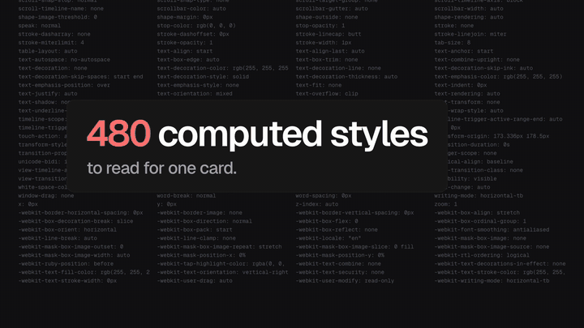

# narrated-product-video

An agent skill that turns a web app or browser extension into a product video: a 45–75 second narrated launch film, a 15–60 second showreel cut to music, or a 5–8 minute app tour. The voice-over or the beat grid is the clock, and every visual lands on it.

[](.github/media/pickcode-launch.mp4)

*[Watch the full 50 s film with sound](.github/media/pickcode-launch.mp4): the PickCode launch film, made end to end with this skill.*

## What it does

- **Writes a true script.** It reads the app's code and UI labels, then has a subagent fact-check every sentence before any voice is generated.
- **Records a natural voice.** It uses Gemini TTS, auditions voices, and gives style direction that avoids the AI-announcer tone. English, French and Arabic.
- **Syncs the picture to the voice.** Parakeet word times drive every scene start and every tween in a HyperFrames composition.
- **Records real app tours.** A Playwright Director adds a fake cursor, captions, chapter covers and spotlights, and paces each beat by its audio.
- **Edits the tour automatically.** It aligns each take, pads with a freeze frame where the voice runs long, fast-forwards idle stretches, skips blank frames and adds zooms.
- **Sounds finished.** Sound effects are keyed to word times, effects duck under the voice, and the mix is mastered to −14 LUFS for social.
- **Moves like a professional cut.** A motion reference with timing in frames, an ease vocabulary, cut-on-motion with a carried object, push-then-cursor camera work, legibility floors and a never-ship list.
- **Never makes the same film twice.** A tone sentence and tone matrix, a transition library in six families, and a shot ledger checked against the last three films.
- **Cuts showreels to music.** One beat grid drives picture and sound, a library track is locked so its final hit lands on the end card (or a score is made in code), and vertical 9:16 and 4:5 cutdowns get safe zones and captions for muted feeds.
- **Films real UI cleanly.** Auto-zoom from logged clicks, cursor timing from travel distance with a slight arc and a press squash, a freeze frame through page loads, redaction at the source, and a ripple switch.
- **Brand kit from a URL.** Colour roles, fonts, logo and copy captured from the live site, with a preview sheet the owner approves before any render.
- **Papercut style on request.** A paper cut-out look (grain, torn tags, taped banners, 2-frame boil) with real screenshots inside paper frames, plus paper foley made in code.
- **Checks itself.** The final film is transcribed and diffed against the script. QA also measures frame 0, frozen time, blank frames, double cuts, dead air, loudness and true peak after an AAC re-encode, then fresh critic agents review it frame by frame.

## Install

With the [skills CLI](https://github.com/vercel-labs/skills) (Claude Code, Codex, Cursor and others):

```bash
npx skills add HoceineEL/narrated-product-video
```

As a Claude Code plugin:

```text
/plugin marketplace add HoceineEL/narrated-product-video
/plugin install narrated-product-video@narrated-product-video
```

Or copy `skills/narrated-product-video` into `~/.claude/skills/`.

## Requirements

| Tool | For |
|---|---|
| `ffmpeg` | every audio and video step |
| Python 3 + `numpy` | scripts |
| `GEMINI_API_KEY` | voice-over (the free tier works for a launch film) |
| [HyperFrames](https://www.npmjs.com/package/hyperframes) (`npx hyperframes`) | launch films, showreels, Parakeet transcription |
| Playwright | app tours, brand kit capture |
| Pillow (optional) | burned captions in cutdowns |

## Use

Ask your agent in plain words:

- "Make a launch video for this app."
- "Record a narrated tour of the dashboard, in French."
- "Redo the voice-over with a male developer voice, no music."
- "Cut a 20 second promo to music, plus a 9:16 version for Reels."
- "Make a papercut explainer of the insights page."

The skill takes it from there: research, script, fact-check, voice, picture, sound, QA.

## Scripts

Every script has `--help`.

```bash
python3 scripts/tts.py --check                                    # validate the Gemini key (free)
python3 scripts/tts.py --voice en-us-podcaster-1 --style "..." --text-file script.txt --out take.wav
python3 scripts/master.py voice take.wav take-m.wav               # master the take
npx hyperframes transcribe take-m.wav -e parakeet -l en           # word times
python3 scripts/word_times.py --transcript transcript.json --anchors anchors.json --out T.json
python3 scripts/mix.py cues.json mix.wav --lib ui=~/sfx/kenney    # voice + effects, ducked
python3 scripts/master.py film render.mp4 final.mp4               # -14 LUFS for social
python3 scripts/beats.py grid --bpm 120 --bars 6 --cue drop=1 --out grid.json   # showreel clock
python3 scripts/cutdown.py final.mp4 --aspect 9:16 --captions words.json --out reel.mp4
python3 scripts/variety.py check film.ledger.json                 # not like the last films
python3 scripts/qa.py --script script.json --video final.mp4      # frame 0, frozen time, cuts, audio, transcript
```

## Layout

```
skills/narrated-product-video/
├── SKILL.md            workflow, rules, script index
├── references/         script, voice, motion, tone and variety, launch film, showreel, app tour, sound, QA, review, styles/papercut
├── scripts/            tts, master, word_times, beats, align, mix, tour_edit, cutdown, variety, qa, paper_sfx, vqa
├── recorder/           Playwright Director, on-page overlay, brand kit capture
├── assets/styles/      papercut CSS, SVG filters and helpers
└── examples/           launch film inputs, French tour script and config, showreel template and ledger
```

## License

MIT. Ideas from other open skills are credited in [CREDITS.md](CREDITS.md).
