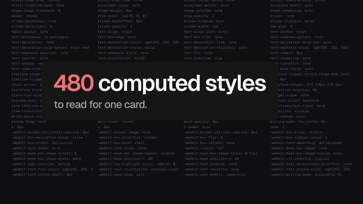

# narrated-product-video

An agent skill that turns a web app or browser extension into a narrated product video: a 45–75 second launch film, or a 5–8 minute app tour. The voice-over is the clock, and every visual lands on the word that describes it.

[](.github/media/pickcode-launch.mp4)

*[Watch the full 50 s film with sound](.github/media/pickcode-launch.mp4): the PickCode launch film, made end to end with this skill.*

## What it does

- **Writes a true script.** It reads the app's code and UI labels, then has a subagent fact-check every sentence before any voice is generated.
- **Records a natural voice.** It uses Gemini TTS, auditions voices, and gives style direction that avoids the AI-announcer tone. English, French and Arabic.
- **Syncs the picture to the voice.** Parakeet word times drive every scene start and every tween in a HyperFrames composition.
- **Records real app tours.** A Playwright Director adds a fake cursor, captions, chapter covers and spotlights, and paces each beat by its audio.
- **Edits the tour automatically.** It aligns each take, pads with a freeze frame where the voice runs long, fast-forwards idle stretches, skips blank frames and adds zooms.
- **Sounds finished.** Sound effects are keyed to word times, effects duck under the voice, and the mix is mastered to −14 LUFS for social.
- **Checks itself.** The final film is transcribed and diffed against the script. QA also measures pauses, blank frames, loudness and true peak.

## Install

With the [skills CLI](https://github.com/vercel-labs/skills) (Claude Code, Codex, Cursor and others):

```bash
npx skills add HoceineEL/narrated-product-video
```

As a Claude Code plugin:

```text
/plugin marketplace add HoceineEL/narrated-product-video
/plugin install narrated-product-video@narrated-product-video
```

Or copy `skills/narrated-product-video` into `~/.claude/skills/`.

## Requirements

| Tool | For |
|---|---|
| `ffmpeg` | every audio and video step |
| Python 3 + `numpy` | scripts |
| `GEMINI_API_KEY` | voice-over (the free tier works for a launch film) |
| [HyperFrames](https://www.npmjs.com/package/hyperframes) (`npx hyperframes`) | launch films, Parakeet transcription |
| Playwright | app tours |

## Use

Ask your agent in plain words:

- "Make a launch video for this app."
- "Record a narrated tour of the dashboard, in French."
- "Redo the voice-over with a male developer voice, no music."

The skill takes it from there: research, script, fact-check, voice, picture, sound, QA.

## Scripts

Every script has `--help`.

```bash
python3 scripts/tts.py --check                                    # validate the Gemini key (free)
python3 scripts/tts.py --voice en-us-podcaster-1 --style "..." --text-file script.txt --out take.wav
python3 scripts/master.py voice take.wav take-m.wav               # master the take
npx hyperframes transcribe take-m.wav -e parakeet -l en           # word times
python3 scripts/word_times.py --transcript transcript.json --anchors anchors.json --out T.json
python3 scripts/mix.py cues.json mix.wav --lib ui=~/sfx/kenney    # voice + effects, ducked
python3 scripts/master.py film render.mp4 final.mp4               # -14 LUFS for social
python3 scripts/qa.py --script script.json --video final.mp4      # transcript diff, gaps, blanks, loudness
```

## Layout

```
skills/narrated-product-video/
├── SKILL.md            workflow, rules, script index
├── references/         script, voice, launch film, app tour, sound, QA
├── scripts/            tts, master, word_times, align, mix, tour_edit, qa, vqa
├── recorder/           Playwright Director and on-page overlay
└── examples/           shipped launch film inputs, French tour script, tour config
```

## License

MIT
